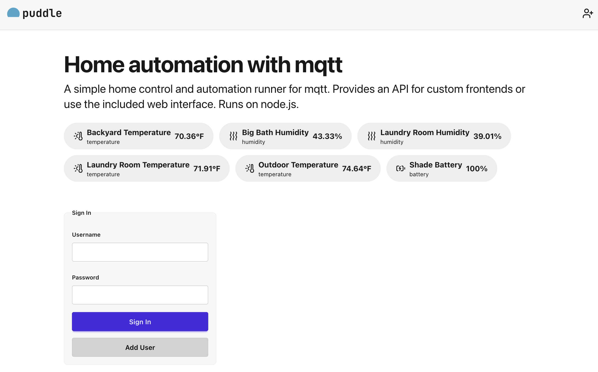
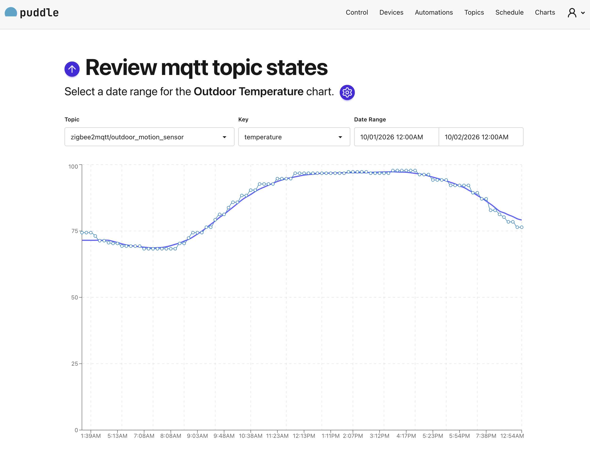
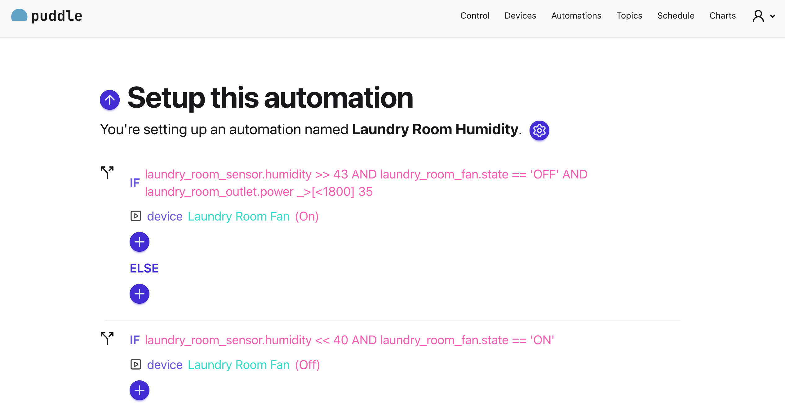
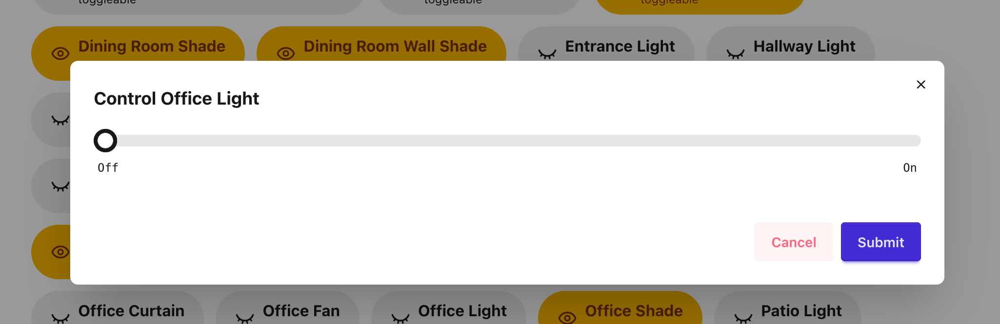
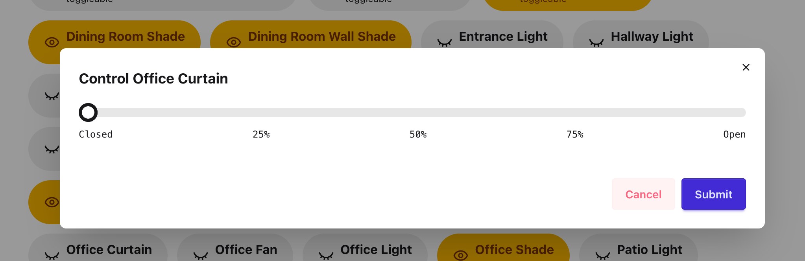

# Puddle


A simple home control and automation runner for [mqtt](https://mqtt.org). Provides an API for custom frontends or use the included web interface. Runs on [Node.js](https://nodejs.org). *Screenshots below!* 🤩

Developed for use with zigbee devices through [zigbee2mqtt](https://www.zigbee2mqtt.io/), but any mqtt devices *should* 🤞 work.

## Features
* Schedule and trigger automations based on mqtt topics, sun position (with [suncalc](https://github.com/mourner/suncalc)) or time
* Allows automations based on expressions (if/else) based on mqtt topics, sun position, time, etc... (with [Ohm](https://ohmjs.org/))
* Provides an API for custom frontends or use the included [React](https://react.dev/) frontend built with [Next.js](https://nextjs.org), [Apollo graphql](https://www.apollographql.com/) and [DaisyUI](https://daisyui.com/)
* Stores messages in a [SQLite](https://www.sqlite.org) db for charting (with [Recharts](https://recharts.github.io)) or automation conditions
* Query past and present device states for automations
* Quick access to favorite device states (e.g., temperature, humidity)
* Provides an interface for manually controlling devices and an overview of all mqtt topics and their use
* Autodetected and manual entry of mqtt topics

## Getting started
Be sure to setup a `puddle.env` and `secret.env` files in the root folder. See the samples of these files for examples. A latitude and longitude should be provided in `puddle.env` for calculating sun positions.

The `secret.env` file sets a authorization phrase for adding users and resetting passwords. This can be disabled once a user account is created.

To setup puddle (now a monorepo) run this in the `root (likely puddle)` folder:
```console
[puddle]$ npm install
```

To setup the database, run this in the `server` folder:
```console
[server]$ npm run migrate latest
```

To build, run the following in the `root` folder. This will build the server, without plugins, and the webapp. If you want to build the server and webapp separately just run `npm run build` in the respective folders.

```console
[puddle]$ npm run build
```

To build plugins you *must* first run `npm install` for each plugin in `src/plugin/` (e.g., in `src/plugin/wemo/wemo-client`). Then to build the server, run this in the `server` folder: 

```console
[server]$ npm run build:plugins
```

To start puddle server:
```console
[server]$ npm run start 
```

To start the webapp:
```console
[nextjs]$ npm run start 
```

The web frontend should now be running at `http://localhost:3000` (unless you've changed the default port). You may need to setup CORs.

## Development Mode
To run in dev mode, run this in the `root` folder:

```console
[puddle]$ npm run dev
```

## Tests
To run tests, make sure `secret.env` exists or some user tests will fail. You can copy `secret.env.sample` to do this. Then:
```console
[server]$ npm run test 
```

## Screenshots
Home page



Charts



Automation setup



Control a toggleable device



Control a positionable device



## Development

Puddle is beta software and, along with this `README.md`, is a work in progress.